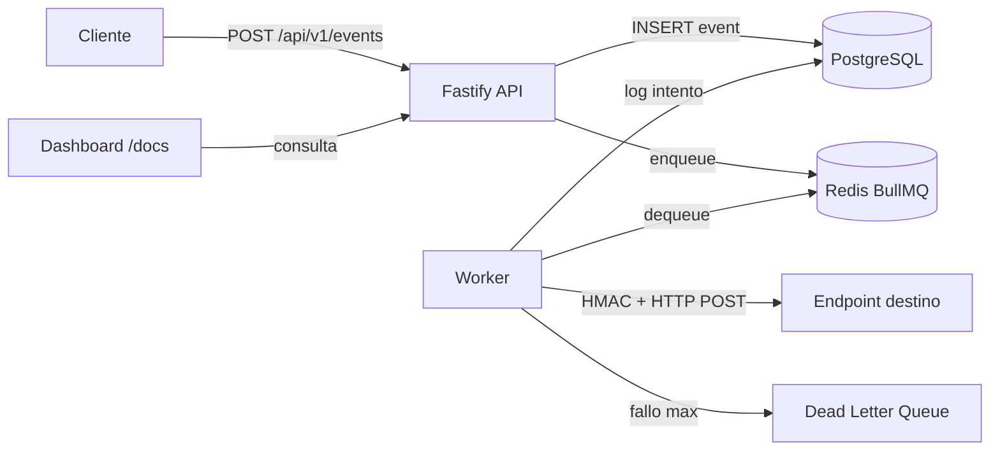

# Webhook Delivery Engine

[](https://github.com/danoglez/webhook-delivery/actions/workflows/ci.yml)

Reliable webhook delivery microservice with HMAC signing, fixed exponential backoff, dead-letter queue, attempt history, and a minimal inspection UI.

## Architecture



## Stack

- **API:** Fastify + TypeScript
- **Queue:** BullMQ + Redis
- **DB:** PostgreSQL
- **Validation:** Zod
- **Docs:** Scalar at `/docs`
- **UI:** Minimal HTML dashboard at `/`
- **Tests:** Vitest integration suite
- **Runtime:** Docker Compose (`postgres`, `redis`, `api`, `worker`)

## Quick start

```bash
cp .env.example .env
docker compose up --build
```

Then open:

- Dashboard: http://localhost:3000/
- API docs: http://localhost:3000/docs
- Health: http://localhost:3000/health

Enqueue an event:

```bash
curl -s -X POST http://localhost:3000/api/v1/events \
  -H 'content-type: application/json' \
  -d '{
    "targetUrl": "https://httpbin.org/post",
    "payload": { "hello": "world" },
    "idempotencyKey": "demo-1"
  }'
```

## API

| Method | Path | Description |
|--------|------|-------------|
| `POST` | `/api/v1/events` | Accept event, persist, enqueue delivery (`202`) |
| `GET` | `/api/v1/events` | Paginated list with last attempt |
| `GET` | `/api/v1/events/:id` | Detail + full attempt history |
| `POST` | `/api/v1/events/:id/retry` | Manual re-enqueue (including DLQ/dead) |
| `GET` | `/health` | Liveness |

Outbound delivery headers:

- `X-Signature: sha256=<hex>`
- `X-Event-Id`
- `X-Timestamp`
- `Content-Type: application/json`

## Idempotency

If `idempotencyKey` is provided on `POST /api/v1/events` and an event with that key already exists, the API returns the **existing** event (`created: false`) and **does not** enqueue a duplicate job.

This keeps client retries safe when the original accept response was lost.

## Backoff & DLQ

Automatic retries use a fixed portfolio schedule:

| After attempt | Delay before next try |
|---------------|------------------------|
| 1 | 30 seconds |
| 2 | 2 minutes |
| 3 | 10 minutes |
| 4 | 1 hour |

- Success (`2xx`) → `succeeded`
- Client errors (`4xx`) → `failed` (no automatic retry)
- Transient failures (`5xx`, network, timeout) → retry with the schedule above
- After the final automatic attempt fails → status `dead` and a job is pushed to `webhooks-dlq`
- Manual `POST /api/v1/events/:id/retry` re-enqueues immediately from any terminal state

HTTP delivery timeout is ~10 seconds.

## Local development (without Compose app containers)

```bash
# start dependencies
docker compose up -d postgres redis

cp .env.example .env
npm install
npm run migrate
npm run dev:api      # terminal 1
npm run dev:worker   # terminal 2
```

## Tests

```bash
npm test
```

Integration-style Vitest suite uses in-memory PostgreSQL (`pg-mem`) plus mocked queue publishers and HTTP `fetch`. CI also boots Postgres/Redis service containers for environment parity with Compose.

Covered scenarios:

1. HMAC signature for a known payload
2. Successful delivery (mocked HTTP 200) → `succeeded` + latency
3. Simulated HTTP 500 → scheduled retry + `attempt_count` increment

## Project layout

```
src/
  app.ts              # Fastify app + Scalar /docs + dashboard
  server.ts           # API bootstrap + migrations
  worker.ts           # BullMQ delivery worker
  config.ts           # Zod env validation
  db/                 # pool + SQL migrations
  routes/events.ts
  services/           # hmac, delivery, events
  queue/              # Redis connection + webhooks / DLQ
  errors/             # centralized error handler
  ui/dashboard.html
tests/
docker-compose.yml
Dockerfile
.github/workflows/ci.yml
```
